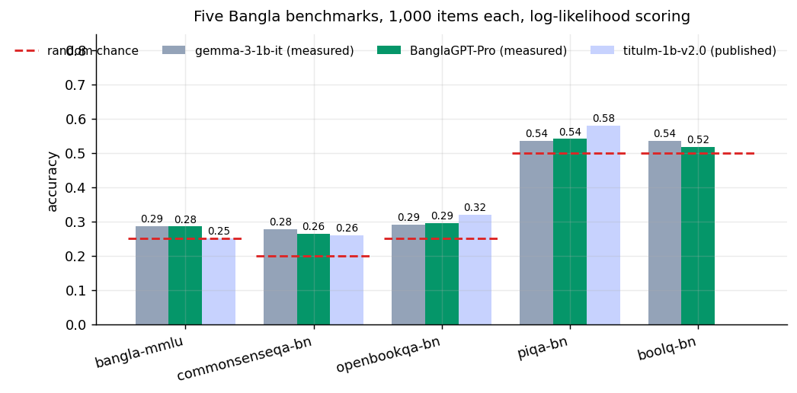
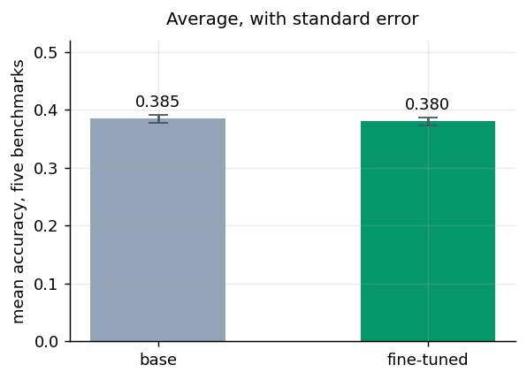
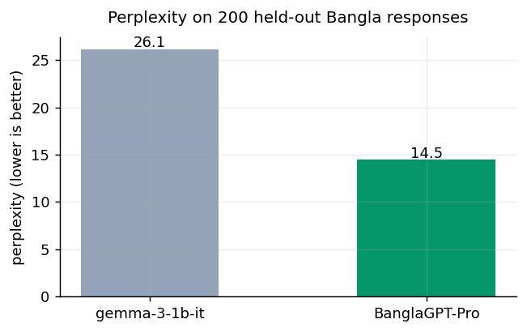

<p align="center">
  <a href="https://huggingface.co/emonHasan01/BanglaGPT-Pro">
    
  </a>
  <a href="https://huggingface.co/spaces/emonHasan01/BanglaGPT-Pro">
    
  </a>
  <a href="https://huggingface.co/emonHasan01/BanglaGPT-Pro-GGUF">
    
  </a>
  <a href="https://huggingface.co/google/gemma-3-1b-it">
    
  </a>
  
  
  
</p>


<div align="center">

[Hugging Face](https://huggingface.co/emonHasan01) | [GitHub](https://github.com/Md-Emon-Hasan) | [LinkedIn](https://www.linkedin.com/in/md-emon-hasan-695483237/) | [WhatsApp](https://wa.me/8801834363533) | [Portfolio](https://emonlabs-ai.hitechparks.com/)

**Author:** [Md. Emon Hasan](https://huggingface.co/emonHasan01)

</div>

# BanglaGPT-Pro

**A full fine-tune of [`google/gemma-3-1b-it`](https://huggingface.co/google/gemma-3-1b-it) for Bangla.**
Every parameter was trained — not LoRA, not an adapter — on
[`Bangla-Instruct`](https://huggingface.co/datasets/md-nishat-008/Bangla-Instruct),
80,000 instruction-response pairs written natively in Bangla rather than translated from
English.

**Perplexity on held-out Bangla falls from 26.10 to 14.51, a 44% reduction.** That is the headline because it is the only measure here without a chance floor. The multiple-choice benchmarks below sit near theirs for both models and separate almost nothing — at 1,000 items the standard error of a difference is ±0.022, and every per-benchmark change is inside that.

## Results

Five Bangla multiple-choice benchmarks at **1,000 items each**, scored by
**length-normalised log-likelihood** — the mean log probability of each option's tokens
given the prompt, highest wins. No generation, no LLM judge, no string matching.



| Benchmark | Chance | `gemma-3-1b-it` | **this model** | Δ | `llama-3.2-1b` † | `titulm-1b-v2.0` † |
|---|---|---|---|---|---|---|
| bangla-mmlu | 0.25 | 0.287 | **0.285** | -0.002 *(noise)* | 0.29 | 0.25 |
| commonsenseqa-bn | 0.20 | 0.278 | **0.264** | -0.014 *(noise)* | 0.22 | 0.26 |
| openbookqa-bn | 0.25 | 0.290 | **0.295** | +0.005 *(noise)* | 0.33 | 0.32 |
| piqa-bn | 0.50 | 0.535 | **0.541** | +0.006 *(noise)* | 0.53 | 0.58 |
| boolq-bn | 0.50 | 0.535 | **0.517** | -0.018 *(noise)* | 0.55 | — |
| **average** | — | 0.385 | **0.380** | -0.005 | — | — |

The first four columns were measured by this notebook. † marks figures **published by
Hishab** on the [`titulm-llama-3.2-1b-v2.0`](https://huggingface.co/hishab/titulm-llama-3.2-1b-v2.0)
card (0-shot), reproduced here, not re-measured.

**Same datasets, different measurement.** Those two columns are on exactly these five
datasets — TituLLM built them — which is why they are in this table at all. But they were
produced with `lm-evaluation-harness`, which feeds the raw question with no chat template
and normalises by character length, while the columns here use the model's chat template
with a Bangla system prompt and normalise by token count. Both are standard; they are not
the same measurement, and the gap between two such setups is commonly a few points. Read
the † columns for **scale**, not for ranking. A dash means Hishab did not report that cell.

What those columns do show cleanly is a pattern rather than a score: their Bangla model
lands **below** the base Llama on Bangla MMLU (0.25 vs 0.29) after 37 billion tokens of
continual pretraining. Whatever the Δ column here turns out to be, that shape is not
peculiar to this model.

**Read the chance column before the accuracy column.** At 1B scale these benchmarks sit
close to guessing for every model in the table. The standard error of a difference between
two columns at 1,000 items is ±0.022, so changes smaller than about 0.04 carry
no information; those are marked *(noise)*.



### Benchmark provenance

| Benchmark | Items used | Splits drawn from | Chance |
|---|---|---|---|
| bangla-mmlu | 1,000 | test(14,750) | 0.25 |
| commonsenseqa-bn | 1,000 | validation(1,221) | 0.20 |
| openbookqa-bn | 1,000 | test(497) + validation(500) + train(4,947) | 0.25 |
| piqa-bn | 1,000 | validation(1,838) | 0.50 |
| boolq-bn | 1,000 | test(729) + validation(432) | 0.50 |

Three of these sets have fewer than 1,000 rows in their test split, so splits were
concatenated to reach the target; the table says which. Three of the five
(`commonsenseqa-bn`, `openbookqa-bn`, `piqa-bn`) are **machine translations of English
datasets** refined by an LLM, per Hishab's cards — worth knowing when reading any Bangla
score built on them.

### Perplexity



| | perplexity |
|---|---|
| `gemma-3-1b-it` | 26.10 |
| **BanglaGPT-Pro** | **14.51** |

Measured on 200 held-out `Bangla-Instruct` responses (shuffled rows
200,000–200,800), far past the slice training drew from. Unlike the
multiple-choice tables this has no floor to sit near, which is why it is the headline.

### Appendix: figures published elsewhere, on different datasets

Read the caveats before the table, because the table is the part that invites a mistake.

**These numbers were not measured here and share no dataset with anything above.** They
come from Table 2 of the [TigerLLM paper](https://aclanthology.org/2025.acl-short.69/) as
reproduced on the [`TigerLLM-1B-it`](https://huggingface.co/md-nishat-008/TigerLLM-1B-it)
card, which evaluates on MMLU-bn (a Bangla slice of MMLU-Pro), PangBench-bn, BanglaQuaD,
mHumanEval-bn, BEnQA and BanglaRQA. Not one of those is one of the five used above. No row
for this model appears below, and none should: a row placed in that table would be the most
misleading thing on this page.

**Three specific problems with it**, beyond the dataset mismatch:

1. It scores Titu-LLM at 0.06 on MMLU-bn, where Hishab's own card reports 0.25 on Bangla
   MMLU. 0.06 also sits below the 0.25 chance floor of a four-option benchmark — a figure a
   working log-likelihood harness cannot really produce.
2. It places a 1B model at 0.61 against GPT-4o-mini's 0.67 on the same benchmark.
3. The current Gemma-3 TigerLLM checkpoints carry no numbers in it at all, only a "+2–4%"
   claim relative to a deprecated LLaMA version.

The ACL version of that paper also notes its results are not reproducible.

So why reproduce it? Because "how does this compare to other Bangla models?" is a fair
question, and the honest answer is that two incompatible benchmark ecosystems exist for
Bangla and most published figures are not comparable with each other. Showing that is more
useful than silence. It is kept here, below the results, labelled, and with the problems
stated first.

| Model | MMLU-bn | PangBench-bn | BanglaQuaD | mHumanEval-bn | BEnQA | BanglaRQA |
|---|---|---|---|---|---|---|
| GPT-3.5 | 0.55 | 0.55 | 0.50 | 0.56 | 0.50 | 0.49 |
| Gemini 1.5 Flash | 0.66 | 0.57 | 0.62 | 0.58 | 0.56 | 0.61 |
| GPT-4o-mini | 0.67 | 0.62 | 0.65 | 0.56 | 0.60 | 0.60 |
| LLaMA 3.2 (11B) | 0.22 | 0.19 | 0.21 | 0.15 | 0.18 | 0.20 |
| Gemma 2 (27B) | 0.35 | 0.51 | 0.43 | 0.64 | 0.50 | 0.56 |
| Pangea (7B) | 0.18 | 0.15 | 0.17 | 0.10 | 0.14 | 0.16 |
| Titu-LLM | 0.06 | 0.19 | 0.08 | 0.02 | 0.17 | 0.21 |
| Bong-LLaMA | 0.05 | 0.12 | 0.08 | 0.02 | 0.15 | 0.13 |
| Bangla-LLaMA | 0.02 | 0.08 | 0.05 | 0.10 | 0.11 | 0.09 |
| Bangla-Gemma | 0.18 | 0.15 | 0.12 | 0.10 | 0.22 | 0.19 |
| TigerLLM 1B, LLaMA 3.2 (deprecated) | 0.61 | 0.55 | 0.68 | 0.61 | 0.59 | 0.62 |
| TigerLLM-9B-it (deprecated) | 0.72 | 0.68 | 0.70 | 0.63 | 0.65 | 0.68 |

None of these models were re-run on the five datasets above. The 9B and 12B checkpoints do
not fit in 16-bit, and quantising them would have produced a fourth
incomparable measurement rather than a comparison. Anyone with the hardware can settle it:
the notebook that produced this card takes a model id and the same five datasets.

### Sample generations

| Prompt | `gemma-3-1b-it` | This model |
|---|---|---|
| বাংলাদেশের মুক্তিযুদ্ধ সম্পর্কে তিনটি বাক্যে লিখুন। | অবশ্যই! বাংলাদেশের মুক্তিযুদ্ধের ইতিহাস নিচে তিনটি বাক্যে তুলে ধরা হলো: বাংলাদেশের মুক্তিযুদ্ধ  | বাংলাদেশের মুক্তিযুদ্ধ ১৯৫২ থেকে ১৯৬৪ সালের মধ্যে সংঘটিত হয়, যখন দেশের স্বাধীনতা সংগ্রামের জন্ |
| রবীন্দ্রনাথ ঠাকুর কে ছিলেন? | রবীন্দ্রনাথ ঠাকুর ছিলেন একজন বিখ্যাত বাঙালি কবি, ঔপন্যাসিক, নাট্যকার, দার্শনিক, সংগীতজ্ঞ, এবং স | রবীন্দ্রনাথ ঠাকুর (১৮৬১-১৯৪১) ছিলেন একটি বিখ্যাত ভারতীয় কবি, নাট্যকার, উপন্যাসিক, দার্শনিক এবং |
| একটি ছোট গল্প লিখুন যেখানে একজন কৃষক বৃষ্টির জন্য অপেক্ষা  | বৃষ্টির জন্য অপেক্ষা করা একজন কৃষকের গল্প: সকালটা শুরু হয়েছিল পাখির কলকাকলি আর ধুলোর আঘাতেই। রফ | একটি ছোট গ্রামে ছিল একটি কৃষক, নাম ছিল রহিম। তিনি তার জমি থেকে সবজি ও ফল উৎপাদন করতেন এবং মাঝে  |
| পানি ফুটলে কী ঘটে, সহজ ভাষায় ব্যাখ্যা করুন। | পানি ফুটলে যা ঘটে, তা হলো: ১. তাপ দেওয়া: যখন পানি ফুটিয়ে নিলে, সেটির তাপমাত্রা বেড়ে যায়। এই তাপ | পানি ফুটলে কী ঘটে, তা বুঝতে হলে আমাদের কিছু মৌলিক পদার্থবিজ্ঞান ধারণা বুঝতে হবে। ### ধাপ ১: তাপ |

These are greedy decodes, and they are in the card because the benchmark tables cannot
answer the question they answer. Read them before trusting any number above.

## Tokenizer efficiency on Bangla

| | tokens per word |
|---|---|
| Bangla | 1.42 |
| English | 1.30 |

Gemma-3's 262k-token vocabulary covers 140+ languages, and Bangla costs **1.1×** as
many tokens per word as English here. Budget context length accordingly.

## Usage

```python
from transformers import AutoTokenizer, AutoModelForCausalLM
import torch

tok = AutoTokenizer.from_pretrained("emonHasan01/BanglaGPT-Pro")
model = AutoModelForCausalLM.from_pretrained("emonHasan01/BanglaGPT-Pro", torch_dtype=torch.float16,
                                             device_map="auto")

messages = [
    {"role": "system", "content": "আপনি একজন সহায়ক সহকারী। সবসময় স্পষ্ট ও সঠিক বাংলায় উত্তর দিন।"},
    {"role": "user", "content": "বাংলাদেশের মুক্তিযুদ্ধ সম্পর্কে তিনটি বাক্যে লিখুন।"},
]
prompt = tok.apply_chat_template(messages, tokenize=False, add_generation_prompt=True)
inputs = tok(prompt, return_tensors="pt", add_special_tokens=False).to(model.device)
out = model.generate(**inputs, max_new_tokens=256, do_sample=True, temperature=0.7)
print(tok.decode(out[0][inputs["input_ids"].shape[1]:], skip_special_tokens=True))
```

The Bangla system prompt was present in every training example and is in
[`prompt_format.json`](prompt_format.json). Results degrade without it.

### llama.cpp

| File | Size |
|---|---|
| `BanglaGPT-Pro.Q4_K_M.gguf` | 0.81 GB |
| `BanglaGPT-Pro.Q8_0.gguf` | 1.07 GB |

```bash
llama-cli -hf emonHasan01/BanglaGPT-Pro-GGUF:Q4_K_M -p "রবীন্দ্রনাথ ঠাকুর কে ছিলেন?" -n 256
```

## Training

| | |
|---|---|
| Base model | `google/gemma-3-1b-it` |
| Method | **full fine-tune**, every parameter, via Unsloth |
| Dataset | `Bangla-Instruct`, 342,391 rows available |
| Examples trained on | **80,000**, one pass, no repeats |
| Steps | 5,000 at batch 2 × 8 accumulation = 16 effective, length-grouped |
| Max sequence length | 512 tokens; longer examples dropped, not truncated |
| Learning rate | 1e-5, cosine schedule |
| Optimizer | `adamw_8bit`, `max_grad_norm=1.0` |

### Decisions that mattered

**Full fine-tuning, and why it fits.** Gemma-3-1B is roughly 2 GB in fp16 and gradients add
2 GB. Plain AdamW would need about 8 GB for its fp32 moment buffers;
`adamw_8bit` brings that to around 2 GB, and gradient checkpointing absorbs the
activations. At 3B this would not fit without quantising the base, at which point it is
QLoRA, not a full fine-tune.

**Learning rate 1e-5, not 2e-4.** Every weight moves here, so steps must be small. LoRA
tolerates 2e-4 because a fraction of a percent of parameters carry the update.

**Native Bangla data, not translated Alpaca.** Most Bangla fine-tunes use machine-translated
Alpaca derivatives, which carry English sentence structure into the model. `Bangla-Instruct`
was written natively: 50 volunteers wrote seed tasks, then GPT-4 and Claude 3.5 Sonnet
expanded them with self-instruct.

**Loss on the assistant turn only.** Prompt tokens are masked to `-100`.

## Limitations

- **1B parameters.** Fluent Bangla is not accurate Bangla. In the sample table above this
  model answers in clean Bangla and still dates the Liberation War wrong. Perplexity says
  it learned the language; that answer says it did not learn the facts.
- **No continual pretraining.** Instruction tuning adapts form, not knowledge. This is the
  main gap between this model and TituLLM or TigerLLM, both of which pretrained on Bangla
  text first.
- **Trained on 512-token examples.** Nothing breaks past that — Gemma-3 handles
  32k — but the fine-tune contributes nothing beyond it and the model prefers answers of
  roughly that length.
- **The benchmarks barely separate anything** at this scale, as the chance column shows.
- **No safety, bias or faithfulness evaluation**, in Bangla or English.
- **English ability was not measured** after fine-tuning. Hishab measured this for their
  model and found large English regressions after Bangla-only training; expect the same
  here, unquantified.
- **Religious, political and regional sensitivity** was not evaluated.

## What a v2 would change

1. **Continual pretraining on Bangla text before instruction tuning.** The largest lever
   by far, and the one every stronger Bangla model used: TituLLM 37B tokens, BongLLaMA
   6.8B, TigerLLM 10M from school textbooks. This model used none.
2. **A larger base.** At 4B, factual capacity stops being the binding constraint, which is
   what the Bangla MMLU column is actually measuring.
3. **More of the dataset.** 80,000 of 342,391 rows were used.
4. **Benchmarks that discriminate at this scale**, plus systematic human reading of
   generations, which is what matters for a writing assistant.

## Reproducing

One trained the model, one produced every number,
chart and table on this page. Raw numbers, timings and the scorer's self-check are in
[`results.json`](results.json).

## Citation

```bibtex
@inproceedings{raihan-zampieri-2025-tigerllm,
  title     = {{TigerLLM} - A Family of {B}angla Large Language Models},
  author    = {Raihan, Nishat and Zampieri, Marcos},
  booktitle = {Proceedings of ACL},
  year      = {2025}
}
@inproceedings{nahin-etal-2025-titullms,
  title     = {{TituLLMs}: A Family of {B}angla {LLM}s with Comprehensive Benchmarking},
  author    = {Nahin, Shahriar Kabir and Nandi, Rabindra Nath and Sarker, Sagor and others},
  booktitle = {Findings of ACL},
  year      = {2025}
}
@software{unsloth,
  title  = {Unsloth}, author = {Daniel Han and Michael Han and Unsloth team},
  year   = {2023}, url = {https://github.com/unslothai/unsloth}
}
```
